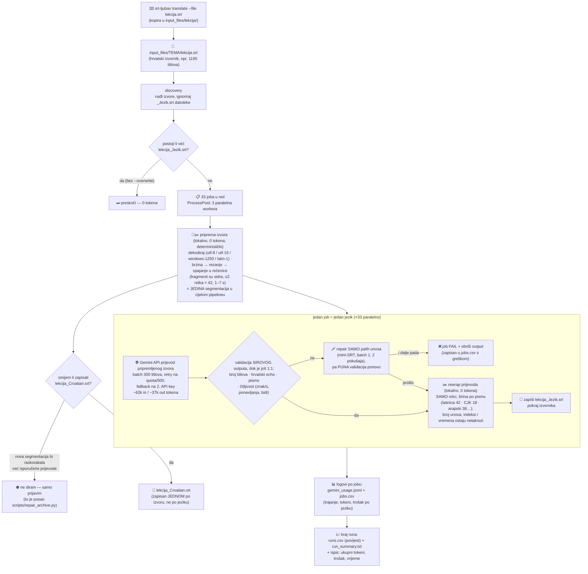

# srt-ljubav

Ubaciš **jedan hrvatski `.srt`** → dobiješ **33 prijevoda** spremna za upload na YouTube.

Pipeline: Gemini API prijevod + automatsko formatiranje titlova na YouTube kvalitetu
(≤2 retka, ograničenja širine po pismu, ~1–7 s po titlu, bez preklapanja).

## Tipičan workflow (tvoj use case) — JEDNA komanda

```bash
uv run srt-ljubav translate --file ~/Downloads/lekcija7.srt
```

To automatski:

1. kopira file u `input_files/lekcija7/lekcija7.srt`
2. prevede SAMO taj file na svih 33 jezika (3 paralelna workera)
3. zapiše prijevode pokraj izvornika: `input_files/lekcija7/lekcija7_English.srt`, `..._German.srt`, … (33 datoteke, spremne za YouTube upload)
4. zabilježi trošak i vrijeme: `usage_logs/jobs.csv` (po jeziku), `runs.csv`, `run_summary.txt`, `gemini_usage.jsonl`

Prvo provjeri plan bez trošenja tokena:

```bash
uv run srt-ljubav translate --file ~/Downloads/lekcija7.srt --dry-run
#    → Source SRT files: 1, Jobs to run: 33
```

Ručna varijanta (više fileova odjednom): kopiraj SRT-ove u `input_files/<TEMA>/` pa samo
`uv run srt-ljubav translate` — prevodi sve izvore kojima fale prijevodi.

Pipeline automatski: **segmentira hrvatski izvornik** (`segment.py`: prvo popravi
brzinu na sirovim fragmentima, zatim reže preduge, pa spaja u rečenice samo bez stanke;
svaka riječ ostaje u vremenu svog fragmenta; rezultat je `lekcija_Croatian.srt`) →
prevodi (Gemini, 1:1 mapiranje) → validira sirovi output → **prelomi samo retke**
prijevoda. Svaki `lekcija_Jezik.srt` tako ostaje 1:1 s hrvatskim: isti broj unosa,
isti indeksi, ista vremena.

## Kako radi (flowchart)



Samo korak 🌐 košta tokene — sve ostalo je lokalna obrada.

## Gdje su podaci o trošku i vremenu

| Datoteka                        | Granularnost                                                       | Format                    |
| ------------------------------- | ------------------------------------------------------------------ | ------------------------- |
| `usage_logs/jobs.csv`           | **1 red = 1 jezik**: trajanje (s), tokeni, trošak, status/greška   | CSV (Excel/Numbers)       |
| `usage_logs/runs.csv`           | **1 red = 1 run**: ukupno vrijeme, jobovi, failovi, tokeni, trošak | CSV, append-only povijest |
| `usage_logs/gemini_usage.jsonl` | 1 red = 1 API poziv (najfinije)                                    | JSONL                     |
| `usage_logs/run_summary.txt`    | sažetak **zadnjeg** runa (prepisuje se)                            | txt                       |

Brzi agregat u terminalu (ukupno + tablica po jeziku s vremenom i troškom):

```bash
uv run srt-ljubav report
```

## Setup (jednom)

```bash
uv sync
echo "GEMINI_API_KEY=..." > .env       # + opcionalno GEMINI_API_KEY2 kao fallback
```

## Ostale komande

```bash
# prevedi samo neke jezike / ponovi prijevod:
uv run srt-ljubav translate --languages "English,German" --overwrite

# jeftin test prije pravog rune (20 linija, 1 jezik, ide u test_outputs/):
uv run srt-ljubav translate --limit-lines 20 --max-jobs 1 --languages English

# postojećim prijevodima prelomi SAMO retke (0 tokena, idempotentno);
# broj unosa, indeksi i timestampovi ostaju 1:1 s _Croatian.srt.
# `reformat` NIKAD ne re-segmentira prijevod — samo prelama retke i prijavljuje
# unose preko 2 retka te svaki file koji nije 1:1 sa svojim _Croatian.srt:
uv run srt-ljubav reformat --dry-run
uv run srt-ljubav reformat

# mirror arhive u Postgres (1 red = 1 titl, s verdiktom validacije po unosu):
uv run srt-ljubav sync-db --dry-run
uv run srt-ljubav sync-db

# popravak STARIH lekcija kojima prijevodi nisu 1:1 s hrvatskim
# (jedini alat koji smije prepisati _Croatian.srt; default je dry-run):
uv run python scripts/repair_archive.py           # samo izvještaj
uv run python scripts/repair_archive.py --apply   # stvarno prepiši

# potrošnja tokena / trošak:
uv run srt-ljubav report
```

Korisni flagovi za `translate`: `--model` (default `gemini-3-flash-preview`),
`--batch-size 300`, `--workers 3`, `--pricing-mode free`, `--no-yt-split`,
`--service-tier flex` (upola jeftinije, dvostruko sporije).

## Troškovi (izmjereno na lekciji od ~1 h)

|                          | Tokeni             | Standard   | Free tier |
| ------------------------ | ------------------ | ---------- | --------- |
| 1 jezik                  | ~62k in / ~37k out | ~$0.14     | $0        |
| svih 33 jezika           | ~2M in / ~1.2M out | **~$4.70** | **$0**    |
| `reformat` / `--dry-run` | 0                  | $0         | $0        |

## Pravila koja pipeline garantira

- Prijevodi žive **flat pokraj izvornika** kao `{ime}_{Jezik}.srt` — nikad podfolderi po jeziku.
- Već prevedene datoteke se **ne prevode ponovo** (osim s `--overwrite`) i ne tretiraju kao izvori.
- Timestampovi se nikad ne kvare: LLM ne dira numeraciju/vremena; YT split dijeli vrijeme
  proporcionalno unutar originalnog prozora, bez preklapanja.
- YT format po pismu: latinica/ćirilica 42 znaka/retku · CJK 18 · korejski 20 · arapski 38 ·
  devanagari 36 · thai 28; brojevi i grapheme clusteri se ne lome.
- Segmentacija se računa **isključivo na `_Croatian.srt`**: prijevodima se prelamaju samo retci
  (`reformat`), pa svaki `{ime}_{Jezik}.srt` ostaje 1:1 s hrvatskim po broju unosa, indeksima i
  vremenima. Unosi koji ne stanu u dva retka se **prijavljuju**, nikad ne dijele.
- `_Croatian.srt` se regenerira samo za izvore koje run stvarno prevodi; ako bi nova segmentacija
  raskorakala već isporučene prijevode, run to odbije i prijavi (za to služi
  `scripts/repair_archive.py`).

## Development

```bash
uv run pytest          # testovi
uv run ruff check      # lint
```

Paket (`src/srtljubav/`): `cli` (entry: `srt-ljubav translate|reformat|sync-db|report`) →
`pipeline` (orkestracija) · `config` (svi tunablevi) · `srtio` (SRT parse/compose) · `segment`
(segmentacija izvora) · `cleaning` + `ytsplit.reflow` (stari segmenter, `--segmenter legacy`) · `ytsplit` (rewrap prijevoda) · `validation`
(čitljivost sirovog outputa) · `scripts` (detekcija pisma) · `languages` · `discovery` ·
`translator` (Gemini wrapper) · `db` (Postgres mirror) · `pricing`/`usage` (troškovi).

Preostalo je 5 jezika:
Western Punjabi
Slovenian
Persian (Farsi)
Serbian
Macedonian
